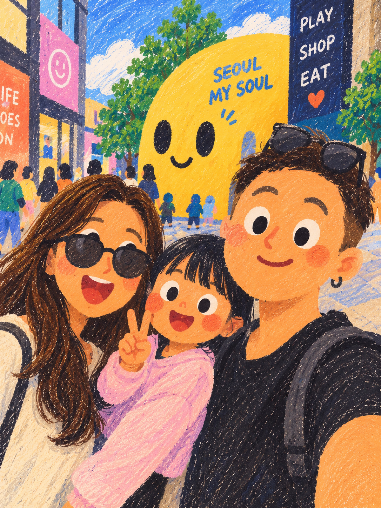

# 童趣蜡笔手绘绘本风 · Playful Crayon Storybook

[](https://github.com/ugoneliu/playful-crayon-storybook-skill/actions/workflows/validate.yaml)

遵循 Agent Skills 目录规范的独立绘画 Skill：将照片、人物和生活场景画成二维扁平、暖杏橙人物、真实材料叠色与纸张肌理的手绘绘本。在连续创作及局部修改中保留人物身份、人数、服饰配件与动作。

仓库：<https://github.com/ugoneliu/playful-crayon-storybook-skill>。这是独立风格 Skill，不是其他人物 IP 仓库的分支或预设。

正式技能名称：**`playful-crayon-storybook-skill`**。安装和调用时使用完整名称，不能省略末尾的 `-skill`。

## 从公开 GitHub 读取

不需要作者账号或私人文件。完整规则位于 [SKILL.md](SKILL.md)，仓库首页只介绍安装与使用。支持网页抓取的工具可以直接读取 [SKILL 原文](https://raw.githubusercontent.com/ugoneliu/playful-crayon-storybook-skill/main/SKILL.md)，再按其指引读取 [示例说明](references/positive-examples.md) 和实际参考图；只看到 README 或只知道技能名称，不等于已加载规范和图片。

[参考图片读取入口](references/positive-examples.md#获取真实参考图片) 列出全部七张 PNG 的本地相对路径与公开原文链接。Agent 须实际读取像素、区分画法与示例内容，再按本次事实组织并提交图片；读取记录或风格文字不能代替生图媒体输入。

此仓库不依赖特定图片供应商、作者密钥或本机目录。实际生成仍需要使用者的运行环境提供图片生成/编辑工具；不能用一个仓库替第三方应用开启其未提供的能力。

### 画风复现还需要实际图像输入

**看过七张例图、读到规范或安装成功，都不等于生图工具收到风格参考。** 严格执行时，先实际查看七张图，再将它们与本次内容图按不同角色提交到真实生图媒体字段；工具容量受限时按 SKILL.md 记录子集与限制。不能只把参考转述成文字后仍宣称七图已作为生图输入。

结果仍需与正向图并排核对脸、眼、头发、衣服和背景的造型与材料。只有橙色皮肤、白眼和腮红，配上光滑实心发片、均匀填色和规整描边，属于风格未通过。顶端 CI 徽章只证明安装、文件与脚本检查；不证明图片模型执行了参考输入或输出画风达标。

已经安装或导入旧版本的环境需要重新读取/更新本仓库 main；GitHub 文件更新不会自动改写旧对话中已经加载的规范。



## 画风与能力

- 稚拙二维色块人物，暖杏橙肤色、圆腮红、大白眼黑瞳、方向性头发笔触。
- 不透明水粉底色、蜡笔与油画棒覆盖、彩铅短线和局部纸色留白；避免光滑插画加噪点及 3D 卡通。
- 人数、身份、服装、配件归属、动作、视线与场景保真；不凭空添加人物、动物或装饰。
- 以最近认可成品为局部编辑基线，锁定区域外内容；跨图复用角色辨识及画风，保留每张照片本来的衣服和动作。
- 检查物件连续结构、前后遮挡、间隙背景与文字载体；避免全图细密均匀斜线造成的彩铅素描漂移。
- 生成后分别检查内容、物理关系、画风和局部锁定。此 Skill 需要运行环境具备图像生成/编辑能力，不保证模型每次生成都通过 QA。

## 安装

在 Codex 中使用内置安装器，可直接输入：

```text
$skill-installer 从 https://github.com/ugoneliu/playful-crayon-storybook-skill 安装这个仓库根目录的 Skill，名称为 playful-crayon-storybook-skill；如果本地已有同名版本，先检查，不要覆盖。
```

也可以手动安装到用户级技能目录；以下命令在同名目录已存在时会停止，不会覆盖：

```sh
mkdir -p "$HOME/.agents/skills"
git clone https://github.com/ugoneliu/playful-crayon-storybook-skill.git \
  "$HOME/.agents/skills/playful-crayon-storybook-skill"
```

只为一个项目安装时，将完整仓库放到该项目的 `.agents/skills/playful-crayon-storybook-skill/`。保留 `references/` 和 `assets/`，不要只复制 `SKILL.md`。通常会自动发现新 Skill；若选择器中未出现，重新启动 Codex。目录与调用方式参见 [OpenAI 官方 Skill 文档](https://learn.chatgpt.com/docs/build-skills)。

本仓库发布与本机安装是两个步骤；GitHub 上可访问并不代表另一个对话已经加载。安装后，在目标对话明确调用，并提供该对话可读取的照片。

### Gemini CLI 原生安装

以下方式已在官方 Gemini CLI 0.64.0 实测，不是 Gemini 手机或网页普通聊天中的操作：

```sh
gemini skills install https://github.com/ugoneliu/playful-crayon-storybook-skill --scope workspace
gemini skills list
```

在自己认可的工作区完成客户端的正常信任与安装确认后，列表应出现 `playful-crayon-storybook-skill [Enabled]`。未受信任的工作区可能不会发现 workspace 技能；按客户端正常流程处理，不应关闭全局保护。安装命令和作用域见 [Gemini CLI 官方文档](https://geminicli.com/docs/cli/skills/)。

## 调用

照片转绘本：

```text
使用 $playful-crayon-storybook-skill，把这张照片画成童趣蜡笔手绘绘本。
保留人数、人物辨识特征、服装配件、动作、视线及场景记忆点，不添加原图之外的人物或动物。
```

局部修改：

```text
使用 $playful-crayon-storybook-skill，以我刚确认的这版为底图。
只把右侧人物左胸的胸针恢复为参考照片里的形状与位置。
锁定其他人的脸、头发、眼镜、衣服、手势，以及背景、画幅、笔触和纸纹。
```

连续创作：

```text
使用 $playful-crayon-storybook-skill，将这三张照片做成同一套绘本插画。
保持角色辨识和画风一致；每张图的服装、配件、动作、人数及场景分别依照对应照片。
```

无照片的原创场景同样可用，请描述人物、人数、穿着与动作；只有明确要求时才加入新角色或动物。无需为了使用此画风先完成其他 IP Skill 的预设问卷。

## 文件导航

| 文件 | 用途 |
| --- | --- |
| [SKILL.md](SKILL.md) | 唯一执行规范：Style DNA、事实与物理关系、生成/编辑、QA 与恢复 |
| [提示词骨架](references/prompt-templates.md) | 组织本次事实、变化与锁定，按需取用 |
| [7 张正向成品](references/positive-examples.md) | 已授权视觉示例及使用边界 |
| [图片清单](assets/positive/manifest.json) | 来源范围、尺寸与 SHA-256 |
| [行为评估](tests/behavioral-evaluation.md) | 场景测试及实际验证范围 |

## 验证

本地包完整性与公开图片白名单检查只依赖 Python 3.9+ 标准库：

```sh
python3 scripts/validate_package.py
```

另外使用 Codex 内置 skill-creator 的 `quick_validate.py` 检查 Skill 清单。行为评估与真实出图测试是不同证据，实际完成范围记录在评估文件中。

### 公开发布验收

2026-10-19，使用不含历史对话的环境，针对公开提交 `b0653b5` 完成以下实际测试：

| 环节 | 实测结果 |
| --- | --- |
| 无 GitHub Token 的公开下载与官方安装器安装 | 通过；18 个下载文件与公开提交一致，含完整 7 张授权图 |
| Codex CLI 新会话发现、读规则及接收参考图 | 通过；发现规范名称，读取规则与相关文字参考；再次显式附带两张下载 PNG 作为图像输入，返回相应视觉观察与工具提示词 |
| Gemini CLI 原生 GitHub 安装及技能发现 | 通过；18 个文件完整一致，受信任临时工作区列出正确名称与 Enabled 状态 |
| 按旧流程进行一次虚构文字出图 | 数量、穿戴、遮挡及画风通过当次视觉检查；生图只传了文字，没有直接风格图片输入，不满足后续新增的严格参考输入门槛 |
| 新版真实参考媒体输入与虚构样例重绘 | 全七图已查看；八图请求被实际五图上限拒绝后，提交 F1 + 四张授权 S 成功；首次材料未通过，经一次针对性纠正后通过该样例的视觉检查。未测试 Gemini 消费者后端 |

公开自动检查会在后续提交上继续运行：Linux、Windows 包校验和回归，非 UTF-8 环境校验，以及从同一个公开 Commit 匿名重新安装并逐文件比对。可点击顶部徽章查看实际运行记录；自动检查不调用图片模型。

上述结果证明公开获取、安装与部分运行链路，不证明不同生成后端会达到相同画风。普通 Gemini 网页/手机聊天、豆包手机普通聊天的原生加载及实际图像生成效果未在本次公开安装测试中验证；不能将 CLI 安装成功推广为它们已完成风格复现。新增参考输入测试及未覆盖项见 [验证记录](tests/behavioral-evaluation.md)。

## 示例与隐私

7 张正向插画由所有者明确授权作为公开 Skill 示例，按原字节保留。原始私人照片与 2 张反例图片均不收录，反例仅抽象成文字规则。未持有原照，不能宣称已验证这些例图相对原照的人物及细节保真。

示例中的人物、地点、路人、星星、服饰图案与配件只属于各自画面，不应自动迁移到新作品。公开展示授权不等于授予示例中的肖像、商标、角色图案或其他第三方权利，也不另行授权任意再分发。未来新增素材须逐项核实来源与公开授权；不明素材不入库。
