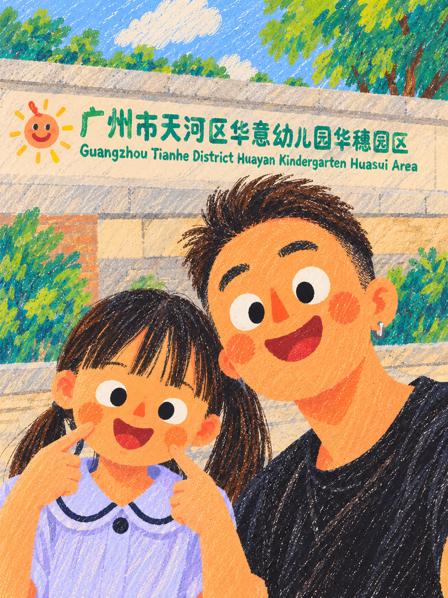
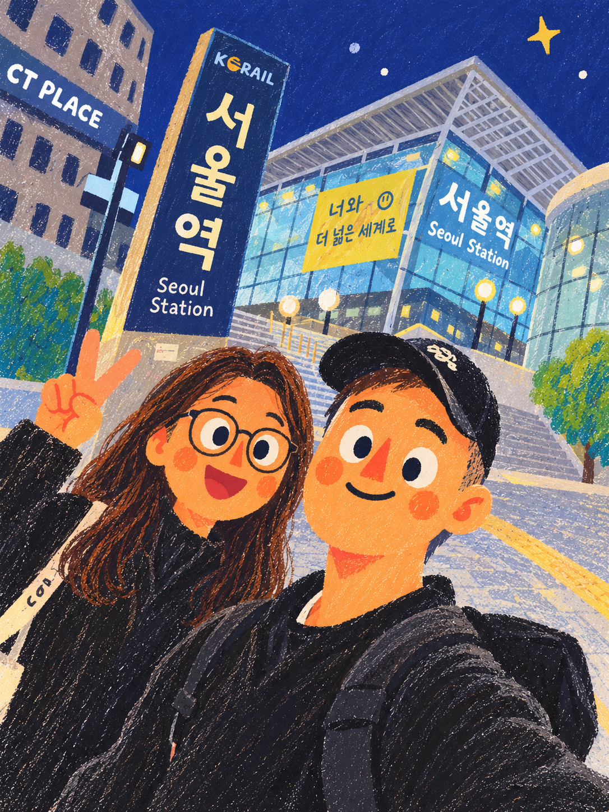
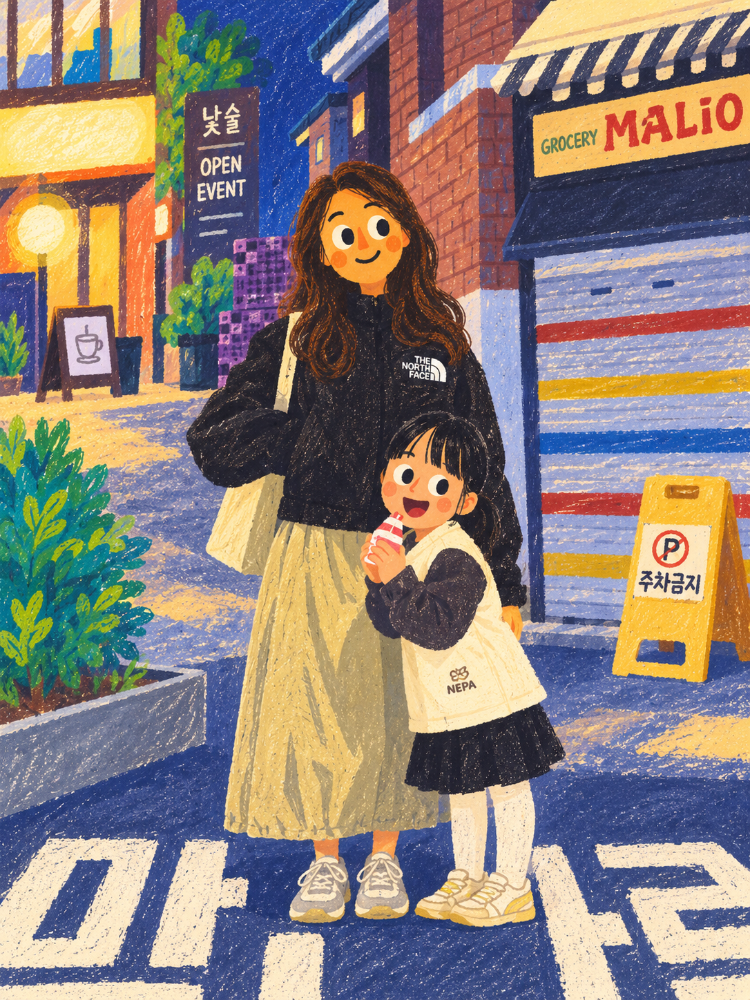
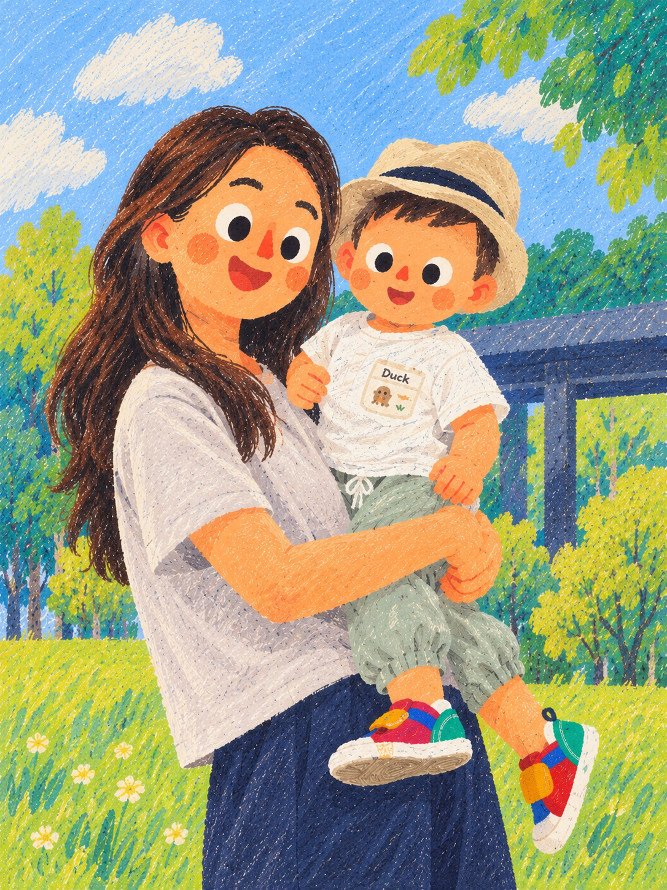
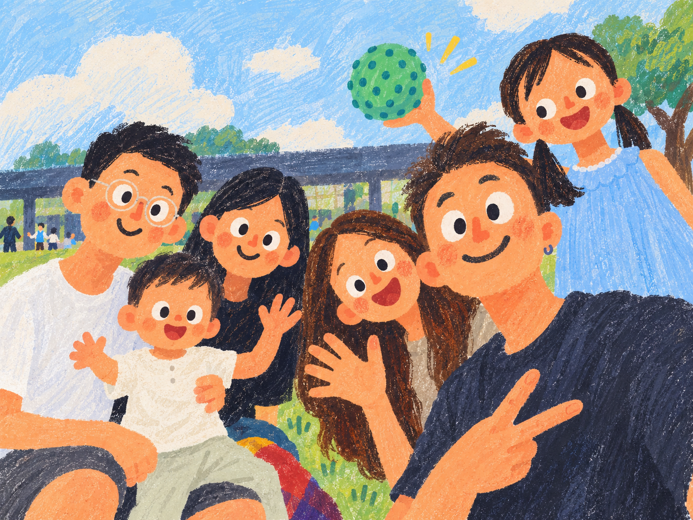
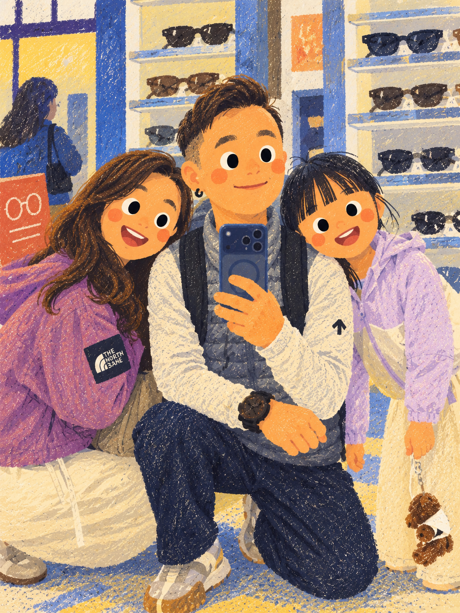

# 正向成品参考

这里收录 7 张由用户生成、经所有者明确授权可作为公开 Skill 示例的正向成品插画。已逐张查看，并将图片内容与原对话对正向及反向案例的描述交叉核对。原始私人照片和反面案例图片均未收录。

这些图片提供的是绘画语言参考。没有可供对照的原始私人照片，因此不能据此声称已经验证人数、人物身份、服饰、配件、物件或场景相对原照片的还原准确度。实际创作时仍须以本次用户提供的内容清单和参考图完成保真 QA。

## 如何使用

- 先阅读 [SKILL.md](../SKILL.md)，首次或漂移后实际查看完整七图；本次生成如何实际提交七图或在工具限制下选择子集，统一按 SKILL.md 第 5 节执行。
- 统一学习扁平造型、暖杏橙肤色、圆腮红、大白眼黑瞳、方向性笔触、材料叠色与纸色留白。
- 示例中的人物、服装、商品、招牌、文字、路人、玩具、星星、图案和其他装饰只属于各自画面；它们不会自动成为新作品可添加的内容。
- 示例没有提供任何一位人物的跨图身份定义。不要仅凭长相相似便合并人物身份，也不要推断人物之间的关系。
- 风格参考只能约束画法；本次用户提供的内容参考约束人数、身份、物件、动作和场景。两者冲突时，重新组织画法，不替换用户的内容。
- 只有执行者看图并转述画风，不等于这些 PNG 已进入生图工具。必须核对该次调用真实媒体字段；不能把本说明或文件名当作像素输入。

## 01 · 日景门前近景

大面积暖杏橙面部、圆形橙红腮红、白眼球与实心黑瞳形成清晰的二维人物语言。头发沿发型走向绘制细短线，衣服中的浅色笔触与背景斜向笔触并不完全相同。文字牌、墙面和植物均用相同材料语言简化，避免人物和背景画法脱节。

## 02 · 夜间车站近景

靛蓝夜空、明黄色灯光和暖杏橙人物构成冷暖关系。建筑玻璃与结构仍可辨识，但以平面色块和短线组织。人物没有因为夜间灯光转为写实体积塑造。现有星形图案只属于此示例，不能因使用夜景风格参考便新增星星。

## 03 · 日间街头近景

亮黄、天蓝、奶油白、粉紫和深棕形成饱和而柔和的复古色彩。黑色眼镜、头发形状、前后遮挡和衣服色块帮助区分人物。近景笔触较清晰，远景行人被概括为小色块，景深通过大小与细节密度表达。

## 04 · 夜间街头站姿

大面积深蓝地面与砖红、奶油黄建筑相互衬托。深色上衣、浅色裙装与鞋子的局部笔触密度不同；明暗主要通过相邻颜色及覆盖色实现。完整站姿与环境使用同样的手绘语汇，避免把人物作为光滑贴纸放在颗粒背景上。

## 05 · 公园中的人物与托抱姿态

草绿、黄绿、浅蓝与暖杏橙构成明亮日景。头发、帽子、衣服和鞋子的材质依靠方向、颜色和密度变化区分。托抱时的手臂、腿部与遮挡关系是内容参考；真实创作时必须从当前输入建立这些关系，不能直接沿用此示例姿态。

## 06 · 六位前景人物的横向构图

多人画面仍保留相同的扁平白眼黑瞳、圆腮红与粗糙填色，头发、眼镜、服装及表情存在差别。前景人物重叠而轮廓可辨；背景细节较少。它可用于观察同一画法如何容纳多人，不构成将任何新画面改为六人的依据。

## 07 · 眼镜店内近景

室内使用奶油黄、蓝灰和粉紫，保持暖色人物及深棕头发的稳定关系。眼镜陈列架、手机与衣服细节被简化为可辨识的形状。衣服与墙面存在不同的交错笔触，纸张露白分散在颜料之间，而非对光滑图像平均覆盖噪点。

## 文件完整性与授权范围

[manifest.json](../assets/positive/manifest.json) 记录每张成品的中性文件名、尺寸、字节数和 SHA-256。7 张图均按原字节复制，没有裁切、调色、重绘或重新编码。PNG 检查只发现图像头、图像数据与结束块，没有附加元数据或尾随数据。

所有者的明确授权范围是将这 7 张成品作为公开 Skill 示例。此说明不另行授予肖像、商标或其他第三方权利，也不授权上传私人原照或反面案例图片。
